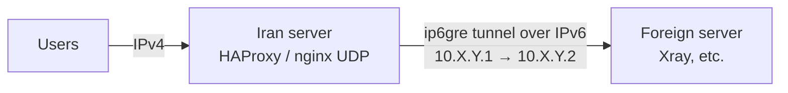

# HAProxy GRE6 Tunnel

[English](#english) | [فارسی](#فارسی)

An ip6gre tunnel between an Iran server and a foreign server, plus TCP/UDP port forwarding through it with HAProxy, configured from a single interactive script.



> Only need plain IPv4 → IPv6 forwarding without a tunnel? See [haproxy-ipv6-forwarder](https://github.com/Arash-Ariaye/haproxy-ipv6-forwarder).
> فقط فوروارد مستقیم IPv4 به IPv6، بدون تانل، می‌خواهید؟ [haproxy-ipv6-forwarder](https://github.com/Arash-Ariaye/haproxy-ipv6-forwarder) را ببینید.

---

## English

### Features

- **Two-step setup:** run the script on the foreign server, copy the connection key it prints, then paste the key on the Iran server.
- **Automatic tunnel test:** the Iran side pings through the tunnel. If the ping succeeds, the script goes straight to port forwarding with the destination already filled in.
- **Missing packages are installed automatically:** iproute2, ping, kmod, nftables, and HAProxy on the Iran server.
- **Fast forwarding:** TCP through HAProxy with kernel splice, and reloads that keep existing connections. UDP goes through a dedicated nginx stream service. PROXY protocol v2 is optional.
- **Survives reboots and repairs itself:** a systemd unit brings the tunnels up at boot, and a timer checks every minute and rebuilds any tunnel, service or port that is down.
- **Multiple tunnels:** one foreign server can serve several Iran servers. Each tunnel gets its own random private network, so tunnels don't collide.
- **Firewall-aware:** GRE (protocol 47) from the peer and traffic inside the tunnel are allowed even when ufw is active.
- **Monitoring:** live traffic per port, connection counts, tunnel ping, and network tuning (BBR, buffers, limits).

### Requirements

| | |
|---|---|
| OS | Debian or Ubuntu with systemd, run as root |
| Network | A working IPv6 address on **both** servers |
| Kernel | The `ip6_gre` module. A KVM or dedicated server is fine; OpenVZ and LXC containers usually don't have it. |
| Path | GRE (IP protocol 47) must not be blocked between the two servers |

### Install and run

Run the same command on **both** servers:

```bash
curl -fsSL https://raw.githubusercontent.com/Arash-Ariaye/haproxy-gre6-tunnel/main/HAProxy-GRE6.sh -o /tmp/gre6.sh && bash /tmp/gre6.sh
```

If you're not root, use `sudo bash /tmp/gre6.sh`. If `curl` is missing:

```bash
wget -qO /tmp/gre6.sh https://raw.githubusercontent.com/Arash-Ariaye/haproxy-gre6-tunnel/main/HAProxy-GRE6.sh && bash /tmp/gre6.sh
```

After the first run the script installs itself as a command, so later you can just run:

```bash
haproxy-forwarder
```

> Download the script to a file as shown above; don't pipe it into bash. The boot-time tunnel unit and the auto-repair timer need the script saved on disk.
>
> If GitHub can't be reached from the Iran server, download `HAProxy-GRE6.sh` elsewhere and copy it over: `scp HAProxy-GRE6.sh root@IRAN_IP:/root/`, then run `bash /root/HAProxy-GRE6.sh`.

### Setup

**1. Foreign server.** Choose `1) Foreign server`:

1. Confirm this server's IPv6 address (it is detected for you) and enter the Iran server's IPv6.
2. Press Enter to accept the suggested tunnel network and MTU 1400.
3. Copy the key that is printed:

```
gre6://djF8MmEwMTo0Zjg6YzAxMDozYTM4OjoxfDIwMDE6ZGI4...
```

The key contains everything the Iran server needs: both IPv6 addresses, the tunnel network and the MTU. It also has a checksum, so a key that was copied incompletely is rejected.

**2. Iran server.** Choose `2) Iran server`:

1. Choose `1) Connection key` and paste the key, or choose `2) Manual` and type the values the foreign server showed.
2. The script creates the tunnel and pings the foreign server through it.
3. If the ping succeeds, you go straight to port forwarding, with the destination already set to the foreign server's tunnel IP. Enter the ports:

```
443,8443          same port on both sides
4040=443          listen on 4040, forward to 443
```

Users then connect to the Iran server's IPv4 address on those ports.

> Services on the foreign server must listen on `0.0.0.0` (all addresses) or on the tunnel IP (`10.X.Y.2`).

### Menu

```
1) Foreign server (Kharej): create a tunnel and get the connection key
2) Iran server: connect the tunnel, test it and forward ports
3) Port forwarding rules (add, remove, status, live monitor)
4) Tunnel status and ping test
5) Show a connection key again (foreign server)
6) Remove a tunnel
7) Network performance tuning (BBR, buffers, limits)
8) Uninstall
```

### Command line

```bash
haproxy-forwarder foreign                  # foreign server setup
haproxy-forwarder iran                     # Iran server setup
haproxy-forwarder tunnels                  # tunnel status + ping
haproxy-forwarder key                      # print the connection key again
haproxy-forwarder add -d 10.10.10.2 -p 443,8443 -y
haproxy-forwarder add -d 10.10.10.2 -p 443 --proto tcp --proxy -y
haproxy-forwarder remove 8443
haproxy-forwarder list | status | monitor | optimize | apply
haproxy-forwarder uninstall [--purge]
haproxy-forwarder --help
```

### Files and services

| Path / unit | Purpose |
|---|---|
| `/etc/haproxy/forwarder-tunnels` | Tunnel definitions |
| `/etc/haproxy/forwarder.rules` | Forwarding rules (HAProxy and nginx configs are rebuilt from this file) |
| `/etc/haproxy/backups/` | The last 10 config backups |
| `haproxy-forwarder-tunnel.service` | Brings the tunnels up at boot |
| `haproxy-forwarder-heal.timer` | Checks and repairs everything every minute |
| `haproxy-forwarder-udp.service` | UDP forwarding (nginx stream) |
| `/usr/local/sbin/haproxy-forwarder` | Installed copy of the script |

### Troubleshooting

| Problem | What to check |
|---|---|
| Tunnel ping fails | Both sides must be created with the same values. Use menu `4` on both servers. |
| | GRE (protocol 47) must be allowed in your provider's or cloud firewall. Some networks block GRE completely, and this tunnel type can't work on those paths. |
| | Check that IPv6 works between the servers: `ping -6 <other IPv6>` |
| `Could not create ...: ip6_gre` | The kernel has no ip6gre support. This is common on OpenVZ/LXC; use a KVM server. |
| Some sites or connections stall | Lower the MTU, for example to 1380, and recreate the tunnel on both sides. |
| Ping works but the port doesn't | The foreign service must listen on `0.0.0.0` or on the tunnel IP. |

### Update and uninstall

To update, run the install command again. Your tunnels and rules are kept.

To uninstall, run `haproxy-forwarder uninstall`. This removes the tunnels, rules and services; backups stay in `/etc/haproxy/backups`.

---

<div dir="rtl">

## فارسی

### این اسکریپت چه کار می‌کند؟

این اسکریپت بین سرور ایران و سرور خارج یک تانل **ip6gre** روی IPv6 می‌سازد. بعد ترافیک کاربران را با **HAProxy** (برای TCP) و **nginx** (برای UDP) از داخل تانل به سرور خارج فوروارد می‌کند. همه این کارها از یک منوی تعاملی انجام می‌شود.

### امکانات

- **راه‌اندازی دو مرحله‌ای:** اسکریپت را روی سرور خارج اجرا کنید، کلید اتصالی را که چاپ می‌کند کپی کنید و روی سرور ایران paste کنید.
- **تست خودکار تانل:** سرور ایران از داخل تانل ping می‌گیرد. اگر جواب آمد، مستقیم به مرحله فوروارد پورت می‌رود و مقصد از قبل تنظیم شده است.
- **نصب خودکار پکیج‌های لازم:** iproute2، ping، kmod، nftables، و HAProxy روی سرور ایران.
- **فوروارد سریع:** TCP با HAProxy و kernel splice، و reload بدون قطع شدن اتصال‌ها. UDP با یک سرویس جداگانه nginx stream. پروتکل PROXY v2 هم اختیاری است.
- **ماندگاری و تعمیر خودکار:** تانل‌ها بعد از ریبوت خودشان بالا می‌آیند. یک تایمر هم هر دقیقه همه چیز را بررسی می‌کند و هر تانل، سرویس یا پورتی که از کار افتاده باشد را دوباره می‌سازد.
- **چند تانل:** یک سرور خارج می‌تواند به چند سرور ایران وصل شود. هر تانل یک شبکه خصوصی تصادفی جدا دارد تا با بقیه تداخل نکند.
- **فایروال:** پروتکل GRE و ترافیک داخل تانل خودکار باز می‌شود، حتی اگر ufw فعال باشد.
- **مانیتورینگ:** ترافیک زنده هر پورت، تعداد اتصال‌ها، ping تانل و بهینه‌سازی شبکه (BBR، بافرها و محدودیت‌ها).

### پیش‌نیازها

- سیستم‌عامل **Debian** یا **Ubuntu** با systemd و دسترسی root
- **IPv6 فعال روی هر دو سرور**
- پشتیبانی کرنل از `ip6_gre`: سرور KVM یا اختصاصی مشکلی ندارد، ولی کانتینرهای OpenVZ و LXC معمولاً این ماژول را ندارند.
- پروتکل **GRE (پروتکل ۴۷)** نباید بین دو سرور مسدود باشد.

### نصب و اجرا

این دستور را روی **هر دو سرور** اجرا کنید:

</div>

```bash
curl -fsSL https://raw.githubusercontent.com/Arash-Ariaye/haproxy-gre6-tunnel/main/HAProxy-GRE6.sh -o /tmp/gre6.sh && bash /tmp/gre6.sh
```

<div dir="rtl">

اگر curl نصب نیست، از wget استفاده کنید:

</div>

```bash
wget -qO /tmp/gre6.sh https://raw.githubusercontent.com/Arash-Ariaye/haproxy-gre6-tunnel/main/HAProxy-GRE6.sh && bash /tmp/gre6.sh
```

<div dir="rtl">

بعد از اولین اجرا، اسکریپت به‌عنوان یک دستور نصب می‌شود و دفعه‌های بعد کافی است این را بزنید:

</div>

```bash
haproxy-forwarder
```

<div dir="rtl">

> **مهم:** اسکریپت را مثل دستور بالا اول در یک فایل دانلود کنید؛ آن را مستقیم با pipe به bash ندهید. برای اینکه تانل بعد از ریبوت بالا بیاید و تعمیر خودکار کار کند، اسکریپت باید روی دیسک ذخیره شده باشد.
>
> **اگر سرور ایران به GitHub دسترسی ندارد:** فایل `HAProxy-GRE6.sh` را روی کامپیوتر خودتان دانلود کنید و با scp به سرور بفرستید. بعد روی سرور `bash /root/HAProxy-GRE6.sh` را اجرا کنید.

### مراحل راه‌اندازی

**مرحله ۱: سرور خارج**

گزینه `1) Foreign server` را انتخاب کنید:

1. IPv6 خود سرور خودکار تشخیص داده می‌شود؛ آن را تأیید کنید. بعد IPv6 سرور ایران را وارد کنید.
2. برای شبکه تانل و MTU (پیش‌فرض ۱۴۰۰) فقط Enter بزنید.
3. کلیدی را که چاپ می‌شود کپی کنید. این کلید با `gre6://` شروع می‌شود.

داخل این کلید همه تنظیماتی که سرور ایران لازم دارد ذخیره شده است: IPv6 هر دو سرور، شبکه تانل و MTU. کلید checksum هم دارد، پس اگر ناقص کپی شده باشد قبول نمی‌شود.

**مرحله ۲: سرور ایران**

گزینه `2) Iran server` را انتخاب کنید:

1. گزینه `1) Connection key` را بزنید و کلید را paste کنید. یا گزینه `2) Manual` را بزنید و مقادیری را که سرور خارج نشان داده دستی وارد کنید.
2. اسکریپت تانل را می‌سازد و از داخل آن به سرور خارج **ping** می‌گیرد.
3. اگر ping جواب داد، مستقیم وارد مرحله **فوروارد پورت** می‌شوید. مقصد از قبل روی IP تانل سرور خارج تنظیم شده و فقط باید پورت‌ها را وارد کنید:

</div>

```
443,8443          same port on both sides  /  پورت یکسان در دو طرف
4040=443          listen 4040 -> forward 443  /  پورت ورودی ۴۰۴۰ به ۴۴۳ خارج
```

<div dir="rtl">

از این به بعد کاربران به **IPv4 سرور ایران** روی همین پورت‌ها وصل می‌شوند.

> سرویس روی سرور خارج (مثلاً Xray) باید روی `0.0.0.0` یا روی IP تانل (`10.X.Y.2`) گوش بدهد.

### منوی اسکریپت

| گزینه | کار |
|---|---|
| 1 | سرور خارج: ساخت تانل و دریافت کلید اتصال |
| 2 | سرور ایران: اتصال تانل، تست و فوروارد پورت |
| 3 | مدیریت رول‌های فوروارد (افزودن، حذف، وضعیت، مانیتور زنده) |
| 4 | وضعیت تانل‌ها و تست ping |
| 5 | نمایش دوباره کلید اتصال (روی سرور خارج) |
| 6 | حذف تانل |
| 7 | بهینه‌سازی شبکه (BBR، بافرها، محدودیت‌ها) |
| 8 | حذف کامل |

### رفع مشکل

| مشکل | راه‌حل |
|---|---|
| ping تانل جواب نمی‌دهد | تنظیمات دو طرف باید یکی باشند؛ با گزینه ۴ روی هر دو سرور بررسی کنید. پروتکل GRE (۴۷) باید در فایروال دیتاسنتر باز باشد. بعضی شبکه‌ها GRE را کاملاً مسدود می‌کنند و روی آن مسیرها این نوع تانل کار نمی‌کند. |
| خطای `ip6_gre` | کرنل از این تانل پشتیبانی نمی‌کند (رایج در OpenVZ و LXC). از سرور KVM استفاده کنید. |
| بعضی سایت‌ها یا اتصال‌ها گیر می‌کنند | MTU را کمتر کنید (مثلاً ۱۳۸۰) و تانل را در هر دو طرف دوباره بسازید. |
| ping کار می‌کند ولی پورت وصل نمی‌شود | سرویس روی سرور خارج باید روی `0.0.0.0` یا IP تانل گوش بدهد. |

### به‌روزرسانی و حذف

- **به‌روزرسانی:** دستور نصب را دوباره اجرا کنید. تانل‌ها و رول‌ها حفظ می‌شوند.
- **حذف کامل:** دستور `haproxy-forwarder uninstall` را اجرا کنید. تانل‌ها، رول‌ها و سرویس‌ها حذف می‌شوند، ولی بکاپ‌ها در `/etc/haproxy/backups` باقی می‌مانند.

</div>
